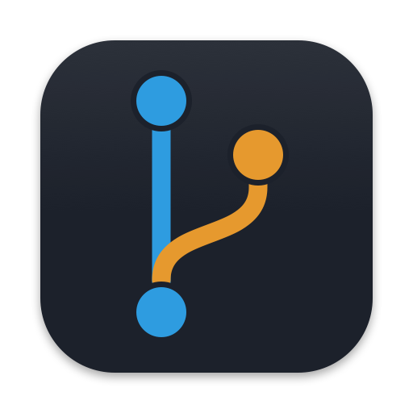
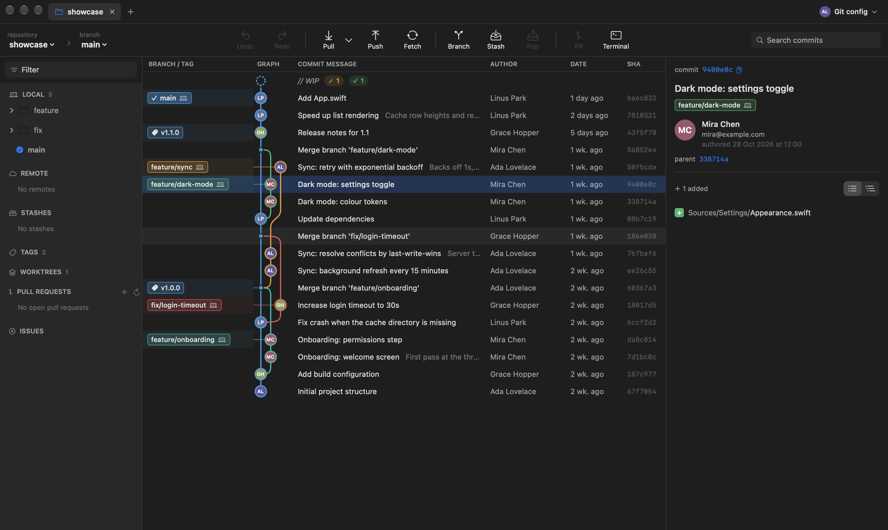

<p align="center"></p>

# Dal

**A fast, native Git client for macOS** — a commit graph you can read at a glance, line-level staging,
drag-and-drop merges, a conflict resolver, GitHub pull requests, Chrome-style tab groups and
switchable Git identities. Built with SwiftUI on top of the `git` you already have.

*Dal* is Turkish for "branch".



## Features

- **Commit graph** — lanes, merges and branch tips with avatars; branch/tag column with local ↔ remote
  badges and ahead/behind counts; search by message, author, SHA or branch (`⌘F`, Enter / ⇧Enter to jump).
- **Staging** — stage, unstage or discard whole files, single hunks or **individual lines**
  (click a line, ⇧-click for a range).
- **Commit composer** — summary + description, amend, `⌘↩` to commit, and a line that shows exactly
  which name/email the commit will carry.
- **Branches** — checkout, create, rename, delete, push, set upstream, fast-forward;
  **drag a branch onto another** to merge or rebase.
- **History editing** — merge, rebase, cherry-pick, revert, reset (soft/mixed/hard), tags.
- **Undo / Redo** for commits, checkouts, branch create/delete, merges, rebases, pulls and resets.
- **Merge tool** — Current and Incoming side by side, pick whole conflicts or single lines, see the common
  ancestor, live output you can edit by hand; Continue / Abort banner for merges, rebases, cherry-picks and reverts.
- **Stashes, tags, worktrees** in the sidebar.
- **GitHub** (via the [GitHub CLI](https://cli.github.com)) — open pull requests and issues in the sidebar,
  create a PR (pushes the branch first), check out a PR.
- **Tab groups** — keep dozens of repositories open; group them like Chrome tabs (name, colour,
  collapse), and jump anywhere with **`⌘P`**. Only the visible tab watches the disk, so many open tabs stay cheap.
- **Profiles** — switch between Git identities (e.g. Personal / Work) from the tab bar, or pin a
  profile to one repository. A profile sets the commit name/email, the GitHub account (`gh auth login`
  multiple accounts) and an optional SSH key. Dal never edits your `~/.gitconfig`; it passes the identity to
  the commands it runs.
- **Auto-updates** via [Sparkle](https://sparkle-project.org) from GitHub Releases.

## Install

**Requirements:** macOS 14 Sonoma or later, and Git. If `git --version` in Terminal asks you to install
the Command Line Tools, accept (or `brew install git`). For pull requests and issues you also need the
GitHub CLI: `brew install gh && gh auth login`.

### Option A — one command in Terminal (recommended)

Downloads the latest release, puts it in `/Applications` and opens it:

```bash
url=$(curl -fsSL https://api.github.com/repos/Bur0/dal-releases/releases/latest | grep -o 'https://[^"]*/Dal-[^"]*\.zip' | head -1) && curl -fsSL "$url" -o /tmp/Dal.zip && ditto -x -k /tmp/Dal.zip /Applications && rm /tmp/Dal.zip && open /Applications/Dal.app
```

A download made with `curl` isn't quarantined, so macOS opens it without the warning below.

### Option B — download in the browser

1. Open [the latest release](https://github.com/Bur0/dal-releases/releases/latest) and download `Dal-x.y.z.zip`.
2. Double-click the zip in Downloads, then drag **Dal.app** into **Applications**.
3. Open Dal. Because it isn't notarized by Apple yet, macOS stops the first launch:
   - **macOS 15 Sequoia and later:** you'll see *"Apple could not verify 'Dal' is free of malware…"*.
     Click **Done**, open **System Settings → Privacy & Security**, scroll down to *"Dal was blocked…"*
     and click **Open Anyway**, then confirm with your password.
   - **macOS 14 Sonoma:** right-click **Dal.app** → **Open** → **Open**.
   - Or skip the dialogs with Terminal: `xattr -dr com.apple.quarantine /Applications/Dal.app`

   This is needed only once.

### First steps

- **Open a repository:** drag a folder onto the welcome screen, use **File → Open Repository…** (`⌘O`) or **Clone Repository…** (`⇧⌘O`),
  or from Terminal: `open -a Dal ~/path/to/repo`.
- **Your identity:** commits use your normal Git name/email. To switch between accounts (e.g. personal and
  work), add profiles in **Dal → Settings → Profiles** and pick one from the tab bar.
- **A repository with its own Git hooks or filters** opens in *Restricted mode* until you click
  **Trust Repository** — Dal won't run programs from a repo you just cloned.

### Updates

Dal checks for a new version every hour (and when you switch back to it), downloads it in the background
and shows **Update ready · Restart Dal** in the tab bar. Click it to restart into the new version, or just
keep working — it installs the next time you quit. You can also use **Dal → Check for Updates…**.
The version you're running is shown in the tab bar.

### Uninstall

Quit Dal, move `/Applications/Dal.app` to the Bin, and optionally remove its settings:

```bash
defaults delete com.burakalpkara.dal; rm -rf ~/Library/Caches/com.burakalpkara.dal
```

### Kurulum (Türkçe özet)

1. **En kolayı:** Terminal'e yukarıdaki *Option A* komutunu yapıştır; Dal indirilir, Uygulamalar'a
   kopyalanır ve açılır.
2. **Tarayıcıdan:** [son sürümdeki](https://github.com/Bur0/dal-releases/releases/latest) `Dal-x.y.z.zip`'i indir,
   açılan **Dal.app**'i **Uygulamalar** klasörüne sürükle. İlk açılışta macOS uyarı verir (Apple onayı yok):
   macOS 15 ve sonrasında **Sistem Ayarları → Gizlilik ve Güvenlik → Yine de Aç**; macOS 14'te sağ tık → **Aç**.
   Ya da Terminal'de: `xattr -dr com.apple.quarantine /Applications/Dal.app`
3. Sonrası otomatik: yeni sürüm çıkınca sekme çubuğunda **Update ready · Restart Dal** görünür.

Gerekenler: macOS 14+, Git (ilk `git` komutunda Command Line Tools kurulumunu kabul et). Pull request'ler için
`brew install gh && gh auth login`.

## Keyboard shortcuts

| | |
|---|---|
| `⌘O` / `⇧⌘O` | Open / clone repository |
| `⌘T` · `⇧⌘W` | New tab · close tab |
| `⌘P` | Go to repository (fuzzy search over open tabs and recents) |
| `⇧⌘]` / `⇧⌘[` | Next / previous tab |
| `⌘F` | Search commits |
| `↑` `↓` | Move through the graph |
| `⌘0` | Show working changes |
| `⇧⌘A` | Stage all |
| `⌘↩` | Commit |
| `⌥⌘F` / `⌥⌘L` / `⌥⌘P` | Fetch / Pull / Push |
| `⌥⌘B` | New branch |
| `⌥⌘S` / `⇧⌥⌘S` | Stash / pop |
| `⌥⌘Z` / `⇧⌥⌘Z` | Undo / redo the last Git action |
| `Esc` | Close the diff |

## Build from source

```bash
brew install xcodegen
git clone https://github.com/Bur0/dal.git && cd dal
scripts/bootstrap.sh          # generates Dal.xcodeproj and opens Xcode
```

Run the tests with `xcodebuild -project Dal.xcodeproj -scheme Dal test`.

### Layout

```
Dal/
  App/      app entry, tabs & groups (AppState), profiles, Sparkle updater
  Git/      git CLI wrapper, parsers, graph lane layout, partial-patch builder, conflict parser
  Store/    RepoStore — one repository's state and every action (checkout, merge, stage…)
  Views/    SwiftUI views
DalTests/   parser, graph, patch and real-git integration tests
scripts/    bootstrap, release, icon generator
```

Dal shells out to `git` and `gh` rather than embedding libgit2, so it behaves exactly like your
command line (hooks, credential helpers, signing, LFS).

## Contributing

Issues and pull requests are welcome. Keep changes small and focused, run the tests before opening a
pull request, and match the existing style (native SwiftUI, `git` CLI underneath, no new dependencies
without a good reason).

## Releasing (maintainers)

```bash
scripts/release.sh 0.2.0 "- What changed"
```

The script bumps the version in `project.yml`, builds a Release app and signs the zip with the Sparkle
EdDSA key from the login keychain. The download and the update feed are published to the [Bur0/dal-releases](https://github.com/Bur0/dal-releases) repo (a GitHub
release with the zip, plus `appcast.xml`, which installed copies poll). It expects a checkout of that
repo next to this one (`../dal-releases`, cloned automatically) or at `$DAL_RELEASES_DIR`.
Generate the key pair once with Sparkle's `generate_keys` and put the public key in `project.yml`
(`SUPublicEDKey`).

## Privacy

Dal talks to the network only for: your Git remotes, GitHub via `gh`, the update feed on GitHub
(`Bur0/dal-releases`), and avatars (a SHA-256 hash of each author's email is sent to Gravatar; turn it off in Settings).

## License

[MIT](LICENSE)
